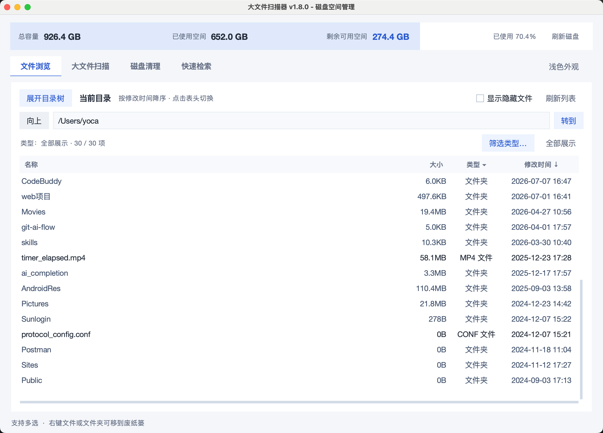
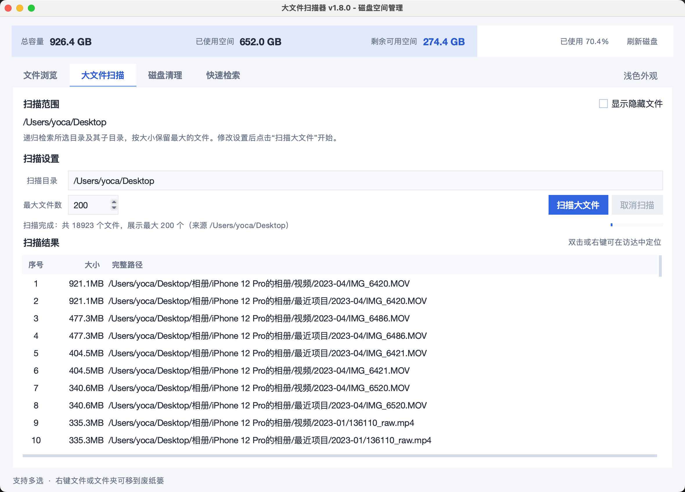
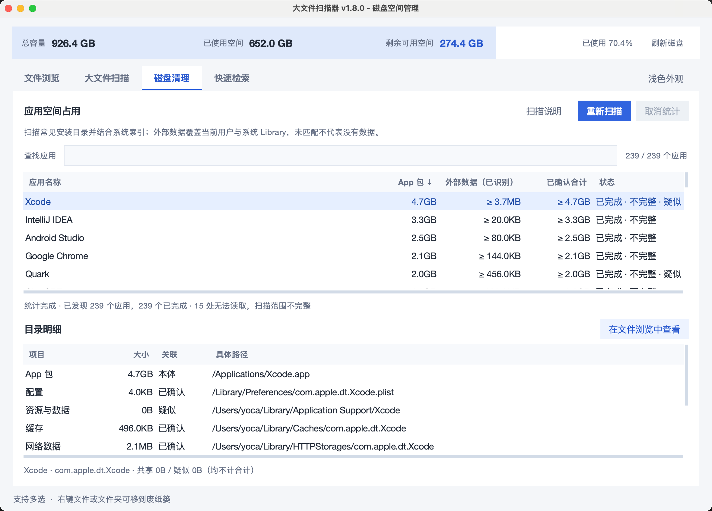
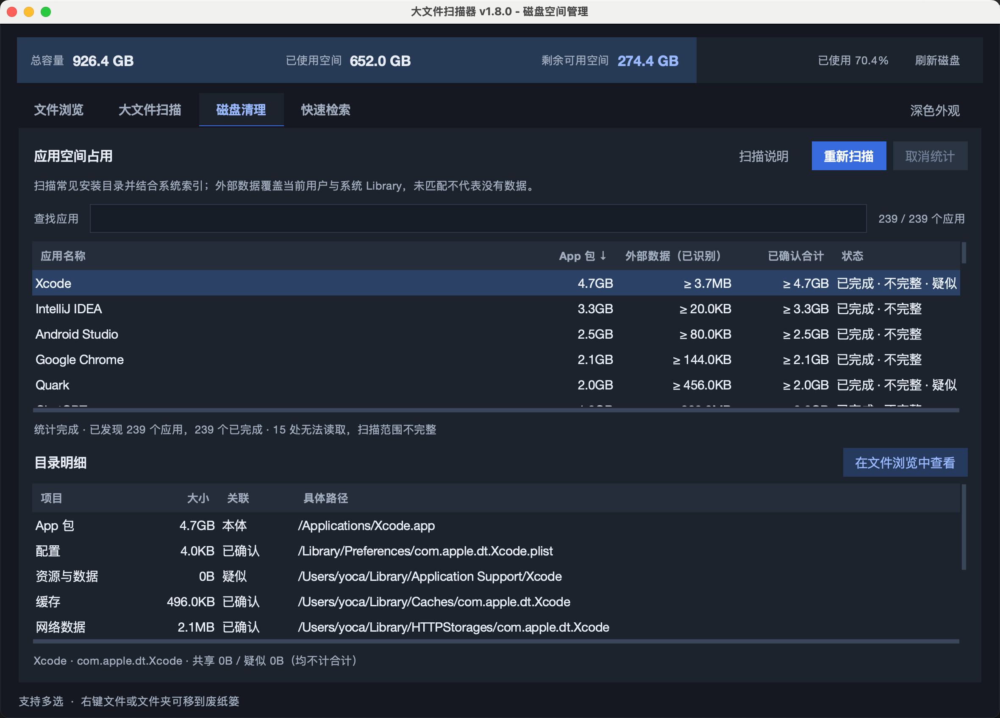

# SafeDiskScanner · 大文件扫描器

一个面向 **macOS** 的本地磁盘空间管理工具，帮助你查看目录大小、定位大文件，并了解应用本体及关联数据的空间占用。

基于 Python、Tkinter/ttk 与少量 Swift 原生辅助代码实现，支持深浅色外观、后台扫描和 macOS 列表选择操作。

> **项目正在持续开发与升级中，功能和文档会随版本更新。欢迎试用，也欢迎通过 Issues 反馈问题、分享使用体验和提出功能建议！**

## 能做什么

| 功能 | 当前能力 |
| --- | --- |
| 磁盘概览 | 一行显示总容量、已用空间、剩余空间及使用比例，可手动刷新 |
| 文件浏览 | 默认打开用户主目录；目录树懒加载，可折叠并记忆状态；支持路径跳转、隐藏文件开关和后台目录大小计算 |
| 排序与类型筛选 | 按大小、修改时间升降序排列；按当前目录的文件后缀、文件夹类型勾选过滤；排序和筛选规则跨目录、跨启动保留 |
| 大文件扫描 | 递归查找指定目录中最大的 N 个文件，可设置结果数量、显示隐藏文件、中途取消；从文件浏览发起扫描会自动切换页面 |
| 应用空间统计 | 发现本机应用，分别展示 App 包、已识别外部数据、已确认合计；支持搜索、排序、取消、重新扫描和目录明细 |
| 手动删除 | 文件浏览和大文件扫描列表支持多选后移到系统废纸篓，操作前确认路径与数量 |
| 列表交互 | 支持 Command+A 全选可见项目、Command 点击追加或取消选择、普通点击单选，以及在访达中定位 |
| 外观切换 | 启动时跟随系统深浅色，也可在标签栏右侧手动切换 |

**当前版本：v1.8.0。** “磁盘清理”页目前提供应用空间分析和目录查看；“快速检索”页已预留入口，功能尚在规划中。

## 界面预览

以下为 v1.8.0 的实际运行截图。应用数量、路径及统计结果来自示例机器，会随设备、权限和扫描范围变化。

### 文件浏览

查看当前目录下的文件和文件夹，按大小或修改时间排序，并按类型筛选。图中目录树已收起，可通过“展开目录树”恢复。



### 大文件扫描

指定扫描目录和保留的最大文件数量，扫描结果按文件大小排列。支持取消扫描，并可在访达中定位文件，或选中后通过右键移到废纸篓。



### 应用空间统计

在“磁盘清理”页查看应用包与已识别外部数据的占用，选中应用后查看具体路径、关联依据及读取状态。共享数据和仅名称匹配的疑似数据单独列出，不计入单个应用的已确认合计。

截图中的 `≥` 和“不完整”表示存在读取或识别范围限制，数值是当前已知的下限。



### 深色外观

页面、列表、输入框和容量概览统一适配深色外观，可通过右上角外观按钮切换。



## 应用数据是怎样统计的

- **应用发现**：枚举 `/Applications`、`~/Applications` 和系统常见应用目录，并通过 Spotlight 索引补充现存的 `.app`。包内辅助应用不重复列举。
- **外部数据关联**：检查当前用户 `~/Library` 和系统 `/Library` 的 Application Support、Caches、Containers、Group Containers、Preferences、Logs 等标准位置，结合应用标识和签名中的 App Group 标识匹配。
- **关联可信程度**：仅名称匹配的目录标为“疑似”；关联多个应用或存在跨应用目录重叠的数据标为“共享”，供用户查看明细。
- **测量方式**：应用空间统计按文件已分配块数估算，单次测量内对硬链接去重，不跟随目录内部的符号链接；文件浏览和大文件扫描展示文件大小。

自定义资源位置、未索引的应用目录和其他用户的数据可能遗漏；`0B` 仅表示已匹配范围为零。APFS 克隆、快照及共享数据也会影响实际可释放空间，因此统计合计不等于卸载后一定能释放的容量。可在页面的“扫描说明”中查看范围和异常明细。

## 删除与权限说明

文件浏览和大文件扫描中的删除操作调用 macOS 原生废纸篓接口，失败时保留错误信息，不会回退到永久删除。删除确认窗口显示项目数量、前 8 个路径，并说明文件夹内容会一起移动。

受 macOS 隐私保护或文件权限限制时，扫描可能请求系统授权或返回读取异常；程序会标记读取权限异常、无法读取或统计不完整。请结合这些状态理解结果。

当前运行逻辑在本地执行，未接入遥测或文件上传功能。分级自动清理、清理白名单规则及 Xcode／模拟器／Docker 专项清理仍有待实现。

## 从源码运行

### 环境

- macOS；当前主要在 Apple Silicon（arm64）环境构建与验证。
- Python 3.10 或以上，并安装可用的 Tkinter；当前开发与构建使用 Python 3.14。
- Xcode Command Line Tools：编译原生废纸篓辅助程序及构建 App 时需要。

在仓库根目录执行：

```bash
python3 -m venv .venv
.venv/bin/python -c "import tkinter; print('Tkinter OK')"

mkdir -p build
xcrun swiftc -O -module-cache-path build/swift-cache trash_helper.swift -o build/trash-helper

.venv/bin/python 大文件扫描器.py
```

应用本身使用 Python 标准库，无需额外安装第三方运行依赖。若 Tkinter 检查失败，需要先为所用 Python 配置 Tkinter；如尚未安装 Xcode Command Line Tools，可运行 `xcode-select --install`。

排序、类型筛选和目录树折叠偏好保存在：

```text
~/Library/Application Support/SafeDiskScanner/settings.json
```

## 构建与测试

### 构建 macOS App

```bash
.venv/bin/python -m pip install pyinstaller
PYINSTALLER_CONFIG_DIR="$PWD/build/pyinstaller-cache" .venv/bin/pyinstaller \
  --noconfirm \
  --distpath dist/local \
  --workpath build/local \
  大文件扫描器.spec
```

产物位于 `dist/local/大文件扫描器.app`，运行该 App 无需另装 Python。`.spec` 会自动编译并包含原生废纸篓辅助程序，当前打包目标为 **arm64**。当前构建使用临时签名，Developer ID 签名及苹果公证流程仍待完善。

`build/`、`dist/` 和 `.venv/` 均不纳入版本控制。更多运行、构建细节见[使用与工程说明](大文件扫描器使用说明.md)。

### 运行回归测试

```bash
.venv/bin/python -m unittest discover -s tests -v
```

测试覆盖扫描、排序、类型筛选、列表选择、目录树偏好、权限异常、废纸篓适配及应用数据关联等行为。原生废纸篓集成验证独立放在 `tests/native_trash_smoke.py`，普通回归测试不会执行该集成操作。

## 工程结构

```text
SafeDiskScanner/
├── 大文件扫描器.py          # 启动、主窗口、文件浏览与大文件扫描
├── ui_theme.py             # 配色、字体和控件样式
├── app_storage/            # 应用空间统计功能包
│   ├── models.py           # 应用、目录、测量结果与用量快照
│   ├── discovery.py        # 应用发现及标识读取
│   ├── association.py      # 外部数据关联、共享与去重
│   ├── measurement.py      # 可取消的空间测量
│   ├── service.py          # 后台流程与结果交付
│   ├── presentation.py     # 显示文本转换
│   ├── view.py             # 页面控件与交互
│   ├── common.py           # 公共校验与取消信号
│   └── __init__.py         # 公开后端接口
├── trash_helper.swift      # macOS 原生废纸篓操作
├── 大文件扫描器.spec        # PyInstaller 构建配置
├── tests/                  # 回归测试及原生验证工具
└── docs/                   # 工程文档与样图
```

新增功能按职责拆分模块，后台任务通过队列向主线程交付结果。模块依赖和开发约定见[工程结构说明](docs/architecture.md)。

## 持续升级与使用反馈

项目会继续完善应用数据识别、扫描性能、异常提示及清理能力，并逐步推进清理规则、风险分级与使用体验优化。后续功能的状态会随版本更新同步到文档中。

**欢迎使用和反馈！** 如果遇到问题，或希望增加某类应用、缓存、构建产物的识别规则，请在仓库 Issues 中说明：

- macOS 版本、芯片类型和应用版本。
- 使用的页面、操作步骤、预期行为与实际结果。
- 如涉及统计或权限问题，附上相关目录类型、错误提示或截图。

也欢迎通过 Pull Request 改进代码、测试、文档和识别能力，一起把这个工具做得更实用。
